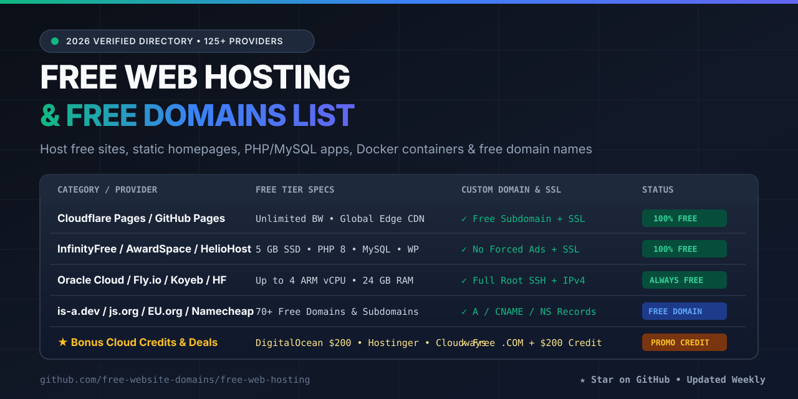

<div align="center">

# Free Web Hosting & Free Domains List (2026): Host Free Sites, Homepages & Web Apps

**The complete, community-verified directory of 125+ providers for free website hosting, free homepage hosting, cloud credits ($200+), and free site domain names — with zero forced ads, free SSL, and honest technical benchmarks.**

[](https://github.com/free-website-domains/free-web-hosting)
[](#-free-domains--free-site-domain-name-providers-70-active-registries)
[](#-featured-free-cloud-credits-free-domain-bundles--budget-deals)
[](LICENSE)
[](https://github.com/free-website-domains/free-web-hosting/stargazers)

[**🔥 $200+ Cloud Credits & Deals**](#-featured-free-cloud-credits-free-domain-bundles--budget-deals) • [**📚 Deep-Dive Guides**](#-deep-dive-guides--category-comparisons) • [**⚡ Host Free Sites (Static/Jamstack)**](#-host-free-sites-best-free-static--homepage-hosting-platforms) • [**🐘 Free PHP, MySQL & WordPress**](#-free-website-hosting-with-php-mysql-cpanel--wordpress) • [**🐳 Free Cloud VPS & Docker**](#-free-full-stack-nodejs-python-docker--cloud-vps-hosting) • [**🌐 Free Domains (70+ List)**](#-free-domains--free-site-domain-name-providers-70-active-registries) • [**🗄️ Free Databases**](#-free-managed-databases-postgresql-mysql-mongodb-redis) • [**❓ FAQ**](#-frequently-asked-questions-faq)

</div>

---

## What is This Directory?

Finding reliable **free web hosting** and a **free site domain name** without hidden renewal traps, forced pop-up advertisements, or sudden account suspensions is harder than ever. Many legacy services (like *000webhost*, *Freenom `.tk/.ml`*, *Heroku Free*, and *Glitch Containers*) have shut down or restricted their free tiers.

This repository is the most comprehensive, actively maintained open-source comparison of **free website hosting** platforms, **free homepage hosting** services, **free web hosting and domain** bundles, and **free domains** for developers, students, startups, and creators. Whether you want to **host free sites** using HTML/CSS/React, get a dynamic **free website hosted** with PHP 8 & MySQL, deploy a full-stack Docker container, or register a permanent **free site domain name**, every verified option is benchmarked below.



---

## 🏆 Featured: Free Cloud Credits, Free Domain Bundles & Budget Deals

> **💡 When should you use a promo credit or $2/mo host instead of 100% free shared hosting?**
> Free shared PHP hosts have strict CPU/inode limits, block outgoing SMTP email, and cannot handle production traffic spikes. If you are launching a business site, e-commerce store, SaaS MVP, or SEO project, claiming a **$200 free cloud credit** or a **free domain + hosting bundle** gives you dedicated resources, 99.99% uptime SLA, and a real `.com` domain name.

| Provider | Exclusive Offer / Free Tier | Storage & Bandwidth | Free Domain / SSL | Best Use Case | Claim Link |
| :--- | :--- | :--- | :---: | :--- | :---: |
| **Hostinger** | **Up to 80% OFF + Free `.com` Domain + 3 Months Free** *(~$1.99–$2.99/mo)* | 100 GB NVMe SSD • Unlimited Bandwidth • Host up to 100 websites | ✅ **Free `.com` / `.net` Domain** (1 yr) + Unlimited Free SSL | Best all-in-one **free web hosting and domain** alternative for WordPress, portfolios & business sites | [**Claim Free Domain + Deal →**](https://www.hostinger.com/) |
| **DigitalOcean** | **$200 Free Cloud Credit** (valid for 60 days) + **3 Free Static Sites Forever** | Deploy NVMe Droplets (VPS), Managed Kubernetes, Postgres & App Platform | ✅ Free `.ondigitalocean.app` + Custom Domain SSL | Best for developers needing full root Linux VPS, Docker apps, or SaaS backends at $0 upfront | [**Get $200 Free Credit →**](https://www.digitalocean.com/) |
| **Cloudways** | **$30 Free Hosting Credit / 3-Day Free Trial** *(No credit card required)* | Managed Cloud Servers on DigitalOcean, AWS & Google Cloud (NVMe + Redis) | ✅ Free Let's Encrypt SSL + Staging URLs + Free Migration | High-speed managed WordPress, WooCommerce, Laravel & PHP apps without sysadmin overhead | [**Start Free Cloud Trial →**](https://www.cloudways.com/) |
| **Namecheap** | **Free `.me` Site Domain Name** (Students) + **$0.98/yr Domains** (`.xyz`, `.site`, `.online`) | Free DNS Hosting, Free Email Forwarding, Free Dynamic DNS (DDNS) | ✅ **Free WhoisGuard Privacy Forever** + PositiveSSL Deals | Best registrar to grab a **free site domain name** (via GitHub Education) or ultra-cheap first-year TLDs | [**Check Free & $0.98 Domains →**](https://www.namecheap.com/) |

---

## ⚖️ Free Web Hosting vs. Low-Cost Production Hosting (Quick Decision Matrix)

Before choosing where to get your **free website hosted**, compare how 100% free tiers stack up against subsidized cloud credits and entry-level shared hosting:

| Feature / Metric | 100% Free Static Hosting *(Cloudflare / GitHub Pages)* | 100% Free PHP/MySQL Hosting *(InfinityFree / ByetHost)* | Free Cloud VPS Credit *(DigitalOcean $200 / Oracle)* | Budget Hosting + Free Domain *(Hostinger / Namecheap)* |
| :--- | :---: | :---: | :---: | :---: |
| **Monthly Cost** | **$0 Forever** | **$0 Forever** | **$0** (Credit / Always-Free) | **~$1.99 – $2.99/mo** |
| **Free Top-Level Domain (`.com`)** | ❌ Bring your own or use subdomain | ❌ Subdomain only | ❌ Bring your own | ✅ **Free `.com` / `.net` Included** |
| **Custom Domain Support** | ✅ Yes (CNAME / A record) | ✅ Yes (NS / CNAME) | ✅ Yes (Full DNS control) | ✅ Yes (Automated) |
| **Free HTTPS / SSL Certificate** | ✅ Automatic Edge SSL | ⚠️ Manual / Basic SSL | ✅ Let's Encrypt / Certbot | ✅ Automatic Wildcard SSL |
| **Backend Languages (PHP/Node/Python)** | ❌ Static / Serverless Edge only | ✅ PHP 8.x + MySQL | ✅ **Any Stack (Root SSH / Docker)** | ✅ PHP, Node.js, Python, WordPress |
| **Forced Ads on Your Website** | ✅ **Zero Ads** | ✅ **Zero Ads** (on verified list) | ✅ **Zero Ads** | ✅ **Zero Ads** |
| **Outgoing Email (SMTP / Custom Mail)** | ❌ Not included | ❌ Blocked on free plans | ✅ Supported (upon verification) | ✅ **Up to 100 Free Business Emails** |
| **Uptime & Performance** | ⚡ **99.99% Global CDN** | ⚠️ ~98.5% (Shared CPU limits) | ⚡ **99.99% Dedicated VM** | ⚡ **99.9% LiteSpeed + NVMe CDN** |

---

## 📚 Deep-Dive Guides & Category Comparisons

Explore our dedicated internal guides and interactive web pages for step-by-step setup instructions, DNS configuration examples, and side-by-side benchmarks:

| Topic / Search Intent | Markdown Guide (GitHub) | Interactive Web Guide (GitHub Pages) | Key Providers Covered |
| :--- | :--- | :--- | :--- |
| **Free Domains & Free Site Domain Names** | [**Free Domains & Subdomains Guide**](guides/free-domains-and-subdomains.md) | [**free-domains.html**](https://free-website-domains.github.io/free-web-hosting/free-domains.html) | `EU.org`, `DigitalPlat`, `is-a.dev`, `js.org`, `Namecheap`, `DuckDNS` |
| **Free Homepage & Static Site Hosting** | [**Free Homepage & Static Hosting Guide**](guides/free-homepage-and-static-hosting.md) | [**free-homepage-hosting.html**](https://free-website-domains.github.io/free-web-hosting/free-homepage-hosting.html) | `Cloudflare Pages`, `GitHub Pages`, `Neocities`, `Netlify`, `Vercel` |
| **Free WordPress, PHP & MySQL Hosting** | [**Free WordPress & PHP/MySQL Guide**](guides/free-wordpress-and-php-mysql-hosting.md) | [**free-wordpress-php-hosting.html**](https://free-website-domains.github.io/free-web-hosting/free-wordpress-php-hosting.html) | `InfinityFree`, `AwardSpace`, `HelioHost`, `Hostinger`, `Cloudways` |
| **Free Cloud VPS, Docker & $200 Credits** | [**Free Cloud VPS & $200 Credits Guide**](guides/free-cloud-vps-and-200-dollar-credits.md) | [**free-cloud-vps-credits.html**](https://free-website-domains.github.io/free-web-hosting/free-cloud-vps-credits.html) | `DigitalOcean $200`, `Oracle Cloud`, `Hugging Face`, `Render`, `Koyeb` |
| **Free Web Hosting vs. Cheap Hosting** | [**Free vs. Cheap Hosting Benchmark**](guides/comparison-free-vs-cheap-hosting.md) | [**Main Web Directory**](https://free-website-domains.github.io/free-web-hosting/) | TTFB latency, SEO subdomain lock-in, SMTP email & `.com` bundles |

---

## ⚡ Host Free Sites: Best Free Static & Homepage Hosting Platforms

If you want to **host free sites** built with HTML, CSS, JavaScript, React, Vue, Next.js, Astro, Hugo, or Jekyll, static edge platforms are the gold standard. They offer **free homepage hosting** with global CDN caching, automatic Git deployments, custom domain support, and **zero forced ads**.

| Platform | Storage Limit | Monthly Bandwidth | Build Minutes / Limits | Free Subdomain | Custom Domain + Free SSL | Commercial Use |
| :--- | :---: | :---: | :--- | :--- | :---: | :---: |
| [**Cloudflare Pages**](https://pages.cloudflare.com/) | 25 MB per file (20,000 files/site) | **Unlimited** | 500 builds/mo • Unlimited sites | `*.pages.dev` | ✅ Yes (Automatic SSL) | ✅ Yes |
| [**GitHub Pages**](https://pages.github.com/) | 1 GB per repo | 100 GB / month | 10 builds/hour via GitHub Actions | `*.github.io` | ✅ Yes (Let's Encrypt) | ⚠️ Non-commercial / Docs |
| [**Vercel**](https://vercel.com/) | 100 MB serverless bundle | 100 GB / month | 6,000 build mins/mo • 100 deploys/day | `*.vercel.app` | ✅ Yes (Automatic SSL) | ❌ Hobby / Non-commercial |
| [**Netlify**](https://www.netlify.com/) | 100 GB asset storage | 100 GB / month | 300 build mins/mo • Forms & Functions | `*.netlify.app` | ✅ Yes (Automatic SSL) | ✅ Yes |
| [**Render Static Sites**](https://render.com/) | Unlimited static files | 100 GB / month | Unlimited team members • Auto Git deploy | `*.onrender.com` | ✅ Yes (Automatic SSL) | ✅ Yes |
| [**DigitalOcean App Platform**](https://www.digitalocean.com/products/app-platform) | **3 Static Sites Free** | 1 GiB / site (starter) | Auto-deploy from GitHub/GitLab + Global CDN | `*.ondigitalocean.app` | ✅ Yes (Automatic SSL) | ✅ Yes |
| [**GitLab Pages**](https://docs.gitlab.com/ee/user/project/pages/) | 10 GB repo limit | Unlimited (Fair use) | 400 CI/CD runner minutes/mo | `*.gitlab.io` | ✅ Yes (Automatic SSL) | ✅ Yes |
| [**Surge.sh**](https://surge.sh/) | Unlimited static projects | Fair use CDN | Instant CLI deploy (`npx surge`) | `*.surge.sh` | ✅ Yes (CNAME support) | ✅ Yes |
| [**Neocities**](https://neocities.org/) | **1 GB Storage** | **200 GB / month** | Built-in browser code editor • Webring community | `*.neocities.org` | ✅ Yes | ✅ Yes |
| [**Firebase Hosting**](https://firebase.google.com/docs/hosting) | 10 GB SSD | 10 GB / month (360 MB/day) | Backed by Google Cloud CDN • CLI deploy | `*.web.app` / `*.firebaseapp.com` | ✅ Yes (Automatic SSL) | ✅ Yes |
| [**Kinsta Static Hosting**](https://kinsta.com/static-site-hosting/) | Up to 100 static sites | 100 GB / month | 600 build mins/mo • 260+ Cloudflare Edge PoPs | `*.kinsta.page` | ✅ Yes (Automatic SSL) | ✅ Yes |
| [**Deno Deploy**](https://deno.com/deploy) | Edge JS/TS & Static | 100 GiB / month | 1,000,000 requests/mo at the edge | `*.deno.dev` | ✅ Yes (Automatic SSL) | ✅ Yes |
| [**Codeberg Pages**](https://codeberg.page/) | FOSS Git repo limit | Fair use | Open-source projects only (Gitea-based) | `*.codeberg.page` | ✅ Yes (Automatic SSL) | ⚠️ FOSS Only |
| [**SourceForge**](https://sourceforge.net/) | Open-source project web | Unlimited FOSS bandwidth | SFTP/SCP upload • PHP & static project web | `*.sourceforge.io` | ✅ Yes | ⚠️ FOSS Only |
| [**Read the Docs**](https://readthedocs.org/) | Documentation hosting | Unlimited for public docs | Sphinx / MkDocs auto-build + PDF generation | `*.readthedocs.io` | ✅ Yes | ⚠️ Docs Only |
| [**Tilda Free**](https://tilda.cc/) | 1 site • 50 pages • 50 MB | Unlimited visits | Visual block builder (no code required) | `*.tilda.ws` | ❌ Paid plans only | ✅ Yes |
| [**Bubble Free**](https://bubble.io/) | Visual web app builder | Development traffic | No-code database + workflow logic | `*.bubbleapps.io` | ❌ Paid plans only | ❌ Dev mode |

### 💡 Which Static Host Should You Pick for Free Homepage Hosting?
1. **Best Overall & Unlimited Traffic:** **Cloudflare Pages** — The only tier-1 platform that gives you **unlimited monthly bandwidth** and commercial usage rights on the free plan.
2. **Best for Open-Source & Developer Portfolios:** **GitHub Pages** — Lives directly inside your repository (`username.github.io`) and integrates seamlessly with free developer domains like `.is-a.dev` and `.js.org`.
3. **Best Retro / Indie Free Homepage Hosting:** **Neocities** — The spiritual successor to GeoCities with 1 GB storage, 200 GB bandwidth, no build step required, and a vibrant community directory.

---

## 🐘 Free Website Hosting with PHP, MySQL, cPanel & WordPress

Need classic dynamic **free web hosting** with a control panel (cPanel / DirectAdmin / VistaPanel / Plesk), **PHP 8+**, **MySQL / MariaDB databases**, and a 1-click **WordPress** installer? Below are the longest-running, verified **free website hosting** providers that **do not inject forced ads** onto your pages.

> ⚠️ **Note on 000webhost:** *000webhost officially shut down in October 2024.* Its parent company (**Hostinger**) migrated users to its low-cost NVMe platform ([**see Hostinger's Free Domain + $1.99/mo offer above**](#-featured-free-cloud-credits-free-domain-bundles--budget-deals)), while **InfinityFree** and **AwardSpace** remain the top 100% free cPanel alternatives.

| Provider | Disk Space | Monthly Bandwidth | Databases & Stack | Control Panel | Forced Ads? | Free Subdomain / Custom Domain |
| :--- | :---: | :---: | :--- | :--- | :---: | :--- |
| [**InfinityFree**](https://infinityfree.com/) | **5 GB SSD** ( up to 3 accounts) | **Unlimited** (50k daily hits limit) | PHP 8.2, MySQL (400 DBs), Softaculous (WordPress) | VistaPanel (cPanel-style) | ✅ **No Ads** | `*.rf.gd`, `*.epizy.com`, `*.42web.io` + Custom Domain |
| [**AwardSpace**](https://www.awardspace.com/free-web-hosting/) | **1,000 MB** | **5 GB / month** | PHP 8.x, 1 MySQL DB (30 MB), Zacky WordPress/Joomla Installer | Custom Hosting Panel + FTP | ✅ **No Ads** | 1 Domain + 3 Free `.dx.am` / `.atwebpages.com` subdomains |
| [**ByetHost**](https://byet.host/free-hosting) | **1,000 MB** | **50 GB / month** | PHP 8, 5 MySQL DBs, FTP, Softaculous Installer | VistaPanel | ✅ **No Ads** | `*.byethost.com` + 5 Addon / Parked Domains |
| [**HelioHost**](https://heliohost.org/) | **1,000 MB** | **Unlimited** | PHP, **Python, Node.js, Ruby, Java**, MySQL & PostgreSQL | **Plesk Control Panel** | ✅ **No Ads** | `*.helioho.st` + Custom Domains + Free SSL |
| [**Alwaysdata**](https://www.alwaysdata.com/en/) | **100 MB** | **Unlimited** | PHP, Python, Node.js, Ruby, Go, Elixir, MySQL, PostgreSQL, CouchDB | Custom Panel + **SSH / WebDAV** | ✅ **No Ads** | `*.alwaysdata.net` + Custom Domains + 100 MB Mailbox |
| [**GoogieHost**](https://googiehost.com/) | **1,000 MB NVMe** | **100 GB / month** | PHP 8, 2 MySQL DBs, LiteSpeed Web Server, WordPress Manager | DirectAdmin | ✅ **No Ads** | `*.cu.ma`, `*.c1.biz` + Custom Domains + Free SSL |
| [**20i Free Hosting**](https://www.20i.com/free-hosting) | **10 GB SSD** (WordPress / PHP) | **25,000 visits / mo** | PHP 8.x, 1x 1GB MySQL DB, Global CDN, 80+ 1-click apps | My20i Panel | ✅ **No Ads** | Free CDN + Custom Domain + Free SSL |
| [**Freehostia**](https://www.freehostia.com/free-plan.html) | **250 MB** | **6 GB / month** | PHP, 10 MB MySQL DB, Elefante 1-Click Script Installer | Hepsia Control Panel | ✅ **No Ads** | Host up to 5 Custom Domains |
| [**ProFreeHost**](https://profreehost.com/) | **Unlimited** (Inode limit) | **Unlimited** | PHP 8, MySQL, Softaculous 1-Click Installer, FTP | Custom cPanel | ✅ **No Ads** | `*.unaux.com`, `*.ezyro.com` + Custom Domains |
| [**AeonFree**](https://aeonfree.com/) | **5 GB Disk** | **Unlimited** | PHP 8, MySQL, Softaculous WordPress, Free SSL | VistaPanel + File Manager | ✅ **No Ads** | Free Subdomain + Custom Domain |
| [**TinkerHost**](https://tinkerhost.net/) | **5 GB Disk** | **100 GB / month** | PHP, MySQL, Softaculous, Free SSL Cert Generator | Client Panel + VistaPanel | ✅ **No Ads** | Free Subdomains + Custom Domains |
| [**x10Hosting**](https://x10hosting.com/) | **500 MB SSD** | **Unlimited** | PHP 8, MySQL, 1-Click WordPress | DirectAdmin Panel | ✅ **No Ads** | `*.x10.mx`, `*.x10.bz` + Custom Domains |
| [**Serv00**](https://www.serv00.com/) | **3 GB SSD** | **Unlimited** | PHP, Python, Node.js, Ruby, Go, Rust, MySQL, PostgreSQL, MongoDB | DevilWEB + **Full SSH (FreeBSD)** | ✅ **No Ads** | `*.serv00.net` + Custom Domains |
| [**Pantheon**](https://pantheon.io/) | Sandbox Sites | Dev/Stage Traffic | Managed **WordPress & Drupal** with Git + Dev/Test/Live workflows | Pantheon Dashboard + Terminus CLI | ✅ **No Ads** | `*.pantheonsite.io` |

---

## 🐳 Free Full-Stack, Node.js, Python, Docker & Cloud VPS Hosting

Want to get a **free website hosted** that runs a persistent backend server (Node.js, Express, FastAPI, Django, Flask, Go, Rust, or Docker containers) or a full Linux Virtual Private Server (VPS)? Compare the best **Always-Free Cloud Tiers** and PaaS platforms below:

| Cloud / PaaS Provider | Free Tier Compute Specs | Storage & Memory | Sleep / Spin-Down Policy | Supported Runtimes | Credit Card Verification? |
| :--- | :--- | :--- | :--- | :--- | :---: |
| [**Oracle Cloud Free Tier**](https://www.oracle.com/cloud/free/) | **Up to 4 ARM Ampere A1 Cores** + 2 AMD Micro VMs | **24 GB RAM** • **200 GB Block SSD** • 10 TB Egress/mo | **Never sleeps (24/7 VPS)** | Full Ubuntu / Debian / Rocky Linux Root SSH | ⚠️ Yes ($0 verification) |
| [**DigitalOcean ($200 Credit)**](https://www.digitalocean.com/) | **Up to $200 in Droplets, K8s & DBs** (60 days) + 3 Static Apps | Configurable NVMe SSD & RAM | **Never sleeps (24/7 VPS)** | Any Linux OS, Docker, Node, Python, One-Click Apps | ⚠️ Yes (Promo activation) |
| [**Google Cloud (GCP) Free Tier**](https://cloud.google.com/free) | **1x `e2-micro` VM** (US regions) + **Cloud Run** (2M req/mo) | 1 GB RAM • 30 GB Standard Persistent Disk | VM runs 24/7 • Cloud Run scales to zero | Full Linux VM + Serverless Docker Containers | ⚠️ Yes ($0 verification) |
| [**AWS Free Tier**](https://aws.amazon.com/free/) | **750 hrs/mo EC2 `t2.micro`/`t3.micro`** (12 mos) + **Lambda** (1M req/mo forever) | 1 GB RAM • 30 GB EBS SSD • 5 GB S3 | EC2 runs 24/7 for 12 months | Linux/Windows EC2, Docker, Serverless | ⚠️ Yes ($0 verification) |
| [**Hugging Face Spaces**](https://huggingface.co/spaces) | **2 vCPU** (Unlimited public spaces) | **16 GB RAM** • 50 GB Ephemeral Disk | Sleeps after 48h inactivity (wakes on visit) | **Docker**, Python (FastAPI/Gradio/Streamlit), Node.js, Static | ✅ **No CC Required** |
| [**Render Web Services**](https://render.com/) | 0.1 CPU shared instance | 512 MB RAM • 100 GB Bandwidth | Spins down after 15 mins idle (wakes in ~30s) | **Docker**, Node.js, Python, Go, Ruby, Rust, Elixir | ✅ **No CC Required** |
| [**Koyeb**](https://www.koyeb.com/) | 1 Free Web Service (`0.1 vCPU`) | 512 MB RAM • 2,000 MB Disk | Eco instance sleep on idle | **Docker**, Node.js, Python, Go, Rust, Git-push deploy | ✅ **No CC Required** |
| [**PythonAnywhere**](https://www.pythonanywhere.com/) | 1 Python Web App + Scheduled Tasks | 512 MB Disk • CPU seconds quota | **Never sleeps** (renew every 3 months with 1 click) | **Python** (Django, Flask, FastAPI, Bottle) + MySQL | ✅ **No CC Required** |
| [**Cloudflare Workers**](https://workers.cloudflare.com/) | **100,000 requests / day** | 128 MB Memory per isolate • Workers KV & D1 SQLite | **0ms cold start** (Global Edge) | JavaScript, TypeScript, Rust/Wasm, Python (Beta) | ✅ **No CC Required** |
| [**Supabase Edge Functions**](https://supabase.com/edge-functions) | **500,000 invocations / month** | Deno-based TypeScript Edge | Instant wake | TypeScript / Deno + Postgres backend | ✅ **No CC Required** |
| [**Vercel Serverless Functions**](https://vercel.com/docs/functions) | **100,000 invocations / month** | 1024 MB Memory • 10s–60s execution | Scales to zero | Node.js, Python, Go, Ruby, Edge Middleware | ✅ **No CC Required** |

---

## 🌐 Free Domains & Free Site Domain Name Providers (70+ Active Registries)

Looking for **free domains** or a **free site domain name** to connect to your GitHub Pages, Cloudflare Pages, Vercel, or VPS? Because Freenom (`.tk`, `.ml`, `.ga`, `.cf`, `.gq`) shut down its registry operations, the community has built reliable alternatives across **three categories**:

1. **Free Top-Level / Public Suffix Domains & Student Packs** (Full DNS / Cloudflare NS support)
2. **Developer & GitOps Free Subdomains** (Claim via GitHub Pull Request or Dashboard — permanent & ad-free)
3. **Free Dynamic DNS (DDNS) Domains** (Ideal for self-hosting, home labs, and VPS IPs)

### 1. Free Top-Level Domains, Public Suffixes & Student Domain Bundles

| Domain Registry / Program | Available Extensions (TLDs / SLDs) | DNS Records Supported | Cloudflare Proxy / Full NS? | Requirements | Official Link |
| :--- | :--- | :--- | :---: | :--- | :---: |
| **Namecheap Education (`nc.me`)** | **`.me`** *(+ discounts on `.tech`, `.live`, `.studio`)* | Full DNS (`A`, `AAAA`, `CNAME`, `MX`, `TXT`, `NS`) | ✅ **Yes (Full TLD)** | Verified Student Email / GitHub Student Pack (Free 1 yr + Free SSL) | [nc.me](https://nc.me/) |
| **Name.com Student Partner** | **`.live`, `.studio`, `.software`, `.games`, `.app`, `.dev`** | Full DNS (`A`, `AAAA`, `CNAME`, `MX`, `TXT`, `NS`) | ✅ **Yes (Full TLD)** | GitHub Student Developer Pack member | [name.com/partner/github-students](https://www.name.com/partner/github-students) |
| **EU.org Free Domain Registry** | **`.eu.org`** *( also country prefixes like `.de.eu.org`, `.nl.eu.org`)* | Full `NS` Delegation | ✅ **Yes (In Mozilla PSL — works on Cloudflare!)** | Free account + pre-configured nameservers (operating since 1996) | [nic.eu.org](https://nic.eu.org/) |
| **DigitalPlat FreeDomain** | **`.dpdns.org`, `.qzz.io`, `.us.kg`, `.xx.kg`** | `NS`, `A`, `AAAA`, `CNAME`, `TXT` | ✅ **Yes (Supports Cloudflare NS)** | Free registration via DigitalPlat dashboard | [domain.digitalplat.org](https://domain.digitalplat.org/) |
| **Public Free Suffix** | **`is-a.si`, `pfsdns.org`, `nastu.net`, `tun.re`, `no.kg`, `so.kg`** | `NS`, `A`, `AAAA`, `CNAME`, `TXT` + REST API & MCP | ✅ **Yes** | Free developer/creator registration (nonprofit) | [publicfreesuffix.org](https://publicfreesuffix.org/) |
| **PP.UA Registry** | **`.pp.ua`** *(Private Person Ukraine)* | Full `NS` Delegation | ✅ **Yes (In Mozilla PSL)** | Free registration via partner registrars + phone/Telegram activation | [pp.ua](https://pp.ua/) |
| **PublicZone.org** | **`.nyc.mn`, `.cn.st`** | Full DNS + Mozilla PSL support | ✅ **Yes (In Mozilla PSL)** | Developers with a GitHub repo (100+ stars) or charitable donation | [PublicZone.org](https://PublicZone.org/) |
| **GNAME `.eu.cc` Program** | **`.eu.cc`** | `A`, `AAAA`, `CNAME`, `MX`, `TXT`, `NS` | ✅ **Yes** | Free program for developers, students, and startups | [gname.com/tld-eu-cc.html](https://www.gname.com/tld-eu-cc.html) |
| **NGO.us Registry** | **`.ngo.us`** | `A`, `AAAA`, `CNAME`, `MX`, `TXT`, `NS` | ✅ **Yes** | Exclusively for nonprofits, NGOs, and open initiatives | [nic.ngo.us](https://nic.ngo.us/) |

---

### 2. Complete Directory of Free Developer Subdomains (GitOps PR & Web Dashboards)

These community-backed registries let you claim a clean, memorable **free site domain name** (such as `yourname.is-a.dev` or `project.js.org`) completely free forever by submitting a JSON/YAML file via a GitHub Pull Request or web dashboard.

| Free Domain Service | Extensions Offered | DNS Records | Registration Method | GitHub Repository | Status |
| :--- | :--- | :--- | :--- | :--- | :---: |
| [**is-a.dev**](https://www.is-a.dev/) | `*.is-a.dev` | `A`, `AAAA`, `CNAME`, `MX`, `TXT`, `URL` | GitHub PR (JSON) | [is-a-dev/register](https://github.com/is-a-dev/register) | ✅ Active |
| [**js.org**](https://js.org/) | `*.js.org` | `CNAME` (GitHub Pages, Vercel, Netlify, etc.) | GitHub PR (`cnames_active.js`) | [js-org/js.org](https://github.com/js-org/js.org) | ✅ Active |
| [**Open Domains**](https://open-domains.net/) | `*.is-cool.dev`, `*.is-a-fullstack.dev`, `*.is-local.org`, `*.is-not-a.dev`, `*.localplayer.dev` | `A`, `AAAA`, `CNAME`, `TXT`, `NS` | GitHub PR | [open-domains/register](https://github.com/open-domains/register) | ✅ Active |
| [**thedev.id**](https://thedev.id/) | `*.thedev.id` | `A`, `AAAA`, `CNAME`, `TXT` | GitHub PR | [thedev-id/thedev.id](https://github.com/thedev-id/thedev.id) | ✅ Active |
| [**thedev.me**](https://thedev.me/) | `*.thedev.me` | `A`, `AAAA`, `CNAME`, `TXT` | GitHub PR | [thedev-me/register](https://github.com/thedev-me/register) | ✅ Active |
| [**is-a-good.dev**](https://is-a-good.dev/) | `*.is-a-good.dev` | `A`, `AAAA`, `CNAME`, `TXT` | GitHub PR | [is-a-good-dev/register](https://github.com/is-a-good-dev/register) | ✅ Active |
| [**Is-Cool-Me**](https://is-pro.dev/) | `*.is-pro.dev`, `*.is-into.tech` | `A`, `AAAA`, `CNAME`, `TXT` | GitHub PR | [is-cool-me/register](https://github.com/is-cool-me/register) | ✅ Active |
| [**is-a.software**](https://is-a.software/) | `*.is-a.software` | `A`, `AAAA`, `CNAME`, `TXT` | GitHub PR | [is-a-software/is-a-software](https://github.com/is-a-software/is-a-software) | ✅ Active |
| [**is-a.bot**](https://www.is-a.bot/) | `*.is-a.bot` | `A`, `AAAA`, `CNAME`, `TXT` | GitHub PR | [free-domains/is-a.bot](https://github.com/free-domains/is-a.bot) | ✅ Active |
| [**cli.rs**](https://cli.rs/) | `*.cli.rs` *(for Rust CLI projects)* | `CNAME` | GitHub PR | [zackify/cli.rs](https://github.com/zackify/cli.rs) | ✅ Active |
| [**is-cod.in**](https://is-cod.in/) | `*.is-cod.in` | `A`, `AAAA`, `CNAME`, `TXT` | GitHub PR | [is-cod-in/register](https://github.com/is-cod-in/register) | ✅ Active |
| [**is-not.cool**](https://is-not.cool/) | `*.is-not.cool` | `A`, `AAAA`, `CNAME`, `TXT` | GitHub PR | [is-not-cool/registration](https://github.com/is-not-cool/registration) | ✅ Active |
| [**vexr.dev**](https://vexr.dev/) | `*.vexr.dev`, `*.is-local.host` | Custom DNS + Cloudflare Proxy | GitHub PR / Web | [nerkoux/vexr.dev](https://github.com/nerkoux/vexr.dev) | ✅ Active |
| [**DNSHE Official**](https://www.dnshe.com/) | `*.us.ci`, `*.cc.cd`, `*.de5.net`, `*.ccwu.cc` | Anycast DNS + REST API | Web Dashboard + PR | [dnshe/DNSHE-FreeDomains](https://github.com/dnshe/DNSHE-FreeDomains) | ✅ Active |
| [**Stackryze Domains**](https://domain.stackryze.com/) | `*.indevs.in`, `*.sryze.cc`, `*.ryzedns.org`, `*.nx.kg` | `A`, `AAAA`, `CNAME`, `TXT`, `NS` | Web Dashboard + PR | [stackryze/FreeDomains](https://github.com/stackryze/FreeDomains) | ✅ Active |
| [**Open Host UK**](https://registry.openhost.uk/) | `*.prvcy.page`, `*.16-b.it`, `*.32-b.it`, `*.64-b.it`, `*.pride.moe`, `*.pride.ngo` | Full DNS Panel | Web Registry | — | ✅ Active |
| [**foo.ng**](https://foo.ng/) | `*.foo.ng` | `A`, `AAAA`, `CNAME`, `TXT` | GitHub PR | [Pokymon/foo.ng](https://github.com/Pokymon/foo.ng) | ✅ Active |
| [**rweb.site**](https://rweb.site/) | `*.rweb.site` | `A`, `AAAA`, `CNAME`, `TXT` | GitHub PR | [katorlys/rweb.site](https://github.com/katorlys/rweb.site) | ✅ Active |
| [**js.cool**](https://js.cool/) | `*.js.cool` *(supports GitHub Pages & Vercel)* | `A`, `CNAME` | GitHub PR | [willin/domain](https://github.com/willin/domain) | ✅ Active |
| [**part-of.my.id**](https://part-of.my.id/) | `*.part-of.my.id` | `A`, `AAAA`, `CNAME`, `TXT` | GitHub PR | [partofmyid/register](https://github.com/partofmyid/register) | ✅ Active |
| [**ill.my.id**](https://ill.my.id/) | `*.ill.my.id` | `A`, `CNAME`, `TXT` | GitHub PR | [w3teal/ill.my.id](https://github.com/w3teal/ill.my.id) | ✅ Active |
| [**devs.surf**](https://devs.surf/) | `*.devs.surf` | `A`, `AAAA`, `CNAME`, `TXT` | GitHub PR | [ByteLogicLabs/Free-Domains](https://github.com/ByteLogicLabs/Free-Domains) | ✅ Active |
| [**getxyz.de**](https://getxyz.de/) | `*.getxyz.de` | `A`, `AAAA`, `CNAME`, `TXT` | GitHub PR | [blackredit/register](https://github.com/blackredit/register) | ✅ Active |
| [**moe.page**](https://moe.page/) | `*.moe.page` | Automated DNS distribution | GitHub PR | [zknmoe/moe.page-subdomains](https://github.com/zknmoe/moe.page-subdomains) | ✅ Active |
| [**iths.online**](https://iths.online/) | `*.iths.online` *(for students & portfolios)* | `A`, `CNAME`, `TXT` | GitHub PR | [harinandsindukumar/free.iths.online](https://github.com/harinandsindukumar/free.iths.online) | ✅ Active |
| [**int.yt**](https://int.yt/) | `*.int.yt` | Short permanent subdomains | GitHub PR | [intentfreedomain/FreeDomain](https://github.com/intentfreedomain/FreeDomain) | ✅ Active |
| [**isroot.in**](https://isroot.in/) | `*.isroot.in` | `A`, `CNAME`, `TXT` | GitHub PR | [nevercode-in/FreeDomains](https://github.com/nevercode-in/FreeDomains) | ✅ Active |
| [**id.thatako.net**](https://id.thatako.net/) | `*.id.thatako.net` | `A`, `CNAME`, `TXT` | GitHub PR | [aitji/id.thatako.net](https://github.com/aitji/id.thatako.net) | ✅ Active |
| [**fluxcast.dev**](https://sub.fluxcast.dev/) | `*.fluxcast.dev` | GitOps DNS | GitHub PR | [IlyaP358/fluxcast-domains](https://github.com/IlyaP358/fluxcast-domains) | ✅ Active |
| [**creepers.sbs**](https://creepers.sbs/) | `*.creepers.sbs`, `*.creepers.cloud` | `A`, `AAAA`, `CNAME`, `TXT` | GitHub PR | [creepersbs/register](https://github.com/creepersbs/register) | ✅ Active |
| [**AgentDomains**](https://agentdomains.co/) | `*.agentdomains.co`, `*.makes.fyi` | `A`, `CNAME`, `TXT` | GitHub PR | [tashfeenahmed/AgentDomains](https://github.com/tashfeenahmed/AgentDomains) | ✅ Active |
| [**NameForge**](https://nameforge.rf.gd/) | Multiple community SLDs | `A`, `CNAME`, `TXT` | GitHub PR | [NameForge-Free-Domain/register](https://github.com/NameForge-Free-Domain/register) | ✅ Active |
| [**env.pm**](https://env.pm/) | `*.env.pm`, `*.jsx.pm` | `A`, `CNAME`, `TXT` | Web Form | — | ✅ Active |
| [**iz.rs**](https://iz.rs/registracija_domena) | `*.iz.rs` | `A`, `CNAME`, `NS` | Web Form | — | ✅ Active |
| [**is-a.stupid.cat**](https://is-a.stupid.cat/) | `*.is-a.stupid.cat` | `A`, `CNAME`, `TXT` | GitHub PR | [is-a-stupid-cat/register](https://github.com/is-a-stupid-cat/register) | ✅ Active |
| [**4k.pics**](https://4k.pics/) | `*.4k.pics` | `A`, `CNAME` | Web Dashboard | — | ✅ Active |
| [**mit-license.org**](https://mit-license.org/) | `*.mit-license.org` *(Hosted MIT License)* | Hosted license card | GitHub PR | [remy/mit-license](https://github.com/remy/mit-license) | ✅ Active |

---

### 3. Free Dynamic DNS (DDNS) & Self-Hosted Free Domains

Hosting a website or personal cloud on a home server, Raspberry Pi, or dynamic IPv4/IPv6 connection? These **free Dynamic DNS** providers give you a **free site domain name** with an automated IP update API:

| DDNS Provider | Free Domains Included | Max Free Hostnames | Expiration / Renewal Policy | IPv6 & Wildcard Support | API / ACME Let's Encrypt DNS-01 |
| :--- | :--- | :---: | :--- | :---: | :---: |
| [**DuckDNS**](https://www.duckdns.org/) | `*.duckdns.org` | **5 subdomains** | **Never expires** (100% free forever) | ✅ IPv4 + IPv6 + TXT | ✅ Full HTTP Token API (Certbot ready) |
| [**deSEC.io**](https://desec.io/) | `*.dedyn.io` (+ Bring Your Own Domain) | **Up to 15 domains** | **Never expires** (Managed DNSSEC) | ✅ IPv4 + IPv6 + Wildcard | ✅ REST API + ACME DNS-01 Hook |
| [**FreeDNS (Afraid.org)**](https://freedns.afraid.org/) | **`*.mooo.com`, `*.crabdance.com` + 23,000+ shared domains** | **5 subdomains** | Active account (login once every 6–12 mos) | ✅ IPv4 + IPv6 + `A/CNAME/MX/TXT` | ✅ Direct URL Update Key |
| [**Dynu**](https://www.dynu.com/) | `*.dynu.net`, `*.ddnsfree.com`, `*.mywire.org` (12+ domains) | **4 subdomains** | **Never expires** (no 30-day click required) | ✅ IPv4 + IPv6 + Wildcard | ✅ DynDNS2 Protocol + REST API |
| [**dynv6**](https://dynv6.com/) | `*.dynv6.net`, `*.dns.army`, `*.dns.navy` | **Unlimited zones** | **Never expires** | ✅ First-class IPv6 prefix + IPv4 | ✅ REST & SSH API + ACME DNS-01 |
| [**FreeMyIP**](https://freemyip.com/) | `*.freemyip.com` | **Unlimited** | **No signup or login required** (token URL) | ✅ IPv4 + IPv6 + TXT | ✅ Single HTTP GET call |
| [**ClouDNS Free**](https://www.cloudns.net/) | `*.cloudns.nz`, `*.cloudns.ph`, `*.cloudns.be` | **1 free DNS zone** (4 Anycast NS) | **Never expires** | ✅ Full DNS records + Dynamic URL | ✅ Dynamic URL script |
| [**No-IP**](https://www.noip.com/) | `*.ddns.net`, `*.hopto.org`, `*.zapto.org` | **3 hostnames** | ⚠️ Requires monthly email confirmation click | ✅ IPv4 + IPv6 (`AAAA`) | ✅ DUC Client |

---

## 🗄️ Free Managed Databases (PostgreSQL, MySQL, MongoDB, Redis)

Many modern **free web hosting** platforms (like Vercel, Netlify, Cloudflare Pages, and Render) do not bundle a built-in database. Pair your frontend or serverless backend with these **100% free managed cloud databases**:

| Database Provider | Engine Type | Free Storage Quota | Compute / Connection Limits | Region & Edge Features | Link |
| :--- | :--- | :---: | :--- | :--- | :---: |
| **Supabase** | **PostgreSQL 15/16** | **500 MB DB** + 1 GB File Storage | Unlimited API requests • 50,000 Monthly Active Users (Auth) | Row-Level Security, Realtime WebSockets, `pgvector` AI | [supabase.com](https://supabase.com/) |
| **Neon** | **Serverless PostgreSQL** | **0.5 GiB Storage** | 190 compute hours/mo • Instant database branching | Autoscaling to zero, sub-second cold wake, pooled connections | [neon.tech](https://neon.tech/) |
| **MongoDB Atlas** | **MongoDB (NoSQL)** | **512 MB Storage** (`M0` Cluster) | Shared RAM/vCPU • 500 max concurrent connections | Deploy on AWS, GCP, or Azure • Atlas Vector Search | [mongodb.com/atlas](https://www.mongodb.com/atlas) |
| **TiDB Cloud Serverless** | **MySQL-Compatible Distributed SQL** | **25 GiB Storage** (5 clusters) | 50 Million Request Units (RUs) / month free | Drop-in MySQL replacement with HTAP & branching | [tidbcloud.com](https://tidbcloud.com/) |
| **Aiven Free Plans** | **MySQL, PostgreSQL & Valkey (Redis)** | **1 GB Storage** (MySQL/PG) | 1 CPU • 1 GB RAM dedicated free node per service | No credit card required • Full connection URI | [aiven.io/free-mysql-database](https://aiven.io/free-mysql-database) |
| **Turso** | **libSQL / SQLite at the Edge** | **9 GB Total Storage** | 500 databases • 500M rows read/month | Embedded replicas, microsecond edge latency | [turso.tech](https://turso.tech/) |
| **Upstash** | **Serverless Redis & Vector** | **256 MB Data** | 500,000 commands / month free | HTTP REST API (works natively in Cloudflare Workers & Vercel Edge) | [upstash.com](https://upstash.com/) |
| **Cloudflare D1 & KV** | **Edge SQLite (`D1`) + Key-Value** | **5 GB Total Storage** (10 DBs) | 5 Million rows read/day • 100,000 rows written/day | Zero-config binding with Cloudflare Pages & Workers | [developers.cloudflare.com/d1](https://developers.cloudflare.com/d1/) |
| **CockroachDB Basic** | **Distributed SQL (Postgres wire)** | **10 GiB Storage** | 50M Request Units / month free | Multi-region survivability, zero maintenance | [cockroachlabs.com](https://www.cockroachlabs.com/) |

---

## 🛠️ How to Get a Free Website Hosted with a Free Domain in 5 Minutes

Follow this battle-tested blueprint to launch a fast, globally cached website with **100% free web hosting and a custom free domain name**:

### Step 1: Deploy Your Site on Free Web Hosting (Cloudflare Pages or GitHub Pages)
1. Push your `index.html` (or Next.js / Astro / Hugo / Vite project) to a public or private GitHub repository.
2. Sign in to [**Cloudflare Pages**](https://pages.cloudflare.com/) (for unlimited bandwidth) or enable **Settings → Pages** in your GitHub repository.
3. Within 30 seconds, your **free website hosted** endpoint goes live at `https://your-project.pages.dev` or `https://username.github.io/repo/`.

### Step 2: Claim a Free Site Domain Name (Or Grab a $0.98–Free `.com` Bundle)
* **Option A (100% Free Developer Subdomain):** Fork [`is-a-dev/register`](https://github.com/is-a-dev/register) (or [`open-domains/register`](https://github.com/open-domains/register)), add `domains/yourname.json` pointing a `CNAME` record to `your-project.pages.dev`, and open a Pull Request. Once merged, your custom SSL certificate is issued automatically!
* **Option B (100% Free Student `.me` / `.live` TLD):** If you have a school `.edu` email, activate the GitHub Student Developer Pack and claim a free `.me` domain at [**Namecheap (`nc.me`)**](https://nc.me/).
* **Option C (Commercial `.com` Brand + WordPress):** If you need a real `.com` for SEO and business branding, grab [**Hostinger's Web Hosting + Free `.com` Domain bundle**](https://www.hostinger.com/) or deploy on [**DigitalOcean with the $200 Free Credit**](https://www.digitalocean.com/).

---

## 💻 Included CLI Tool: Search & Filter 125+ Hosting & Domain Providers Locally

This repository includes a zero-dependency Python 3 CLI utility ([`hosting_finder.py`](hosting_finder.py)) and a structured JSON dataset ([`providers.json`](providers.json)) so you can query, filter, and export free web hosting and free domain providers right from your terminal.

```bash
# Clone the repository
git clone https://github.com/free-website-domains/free-web-hosting.git
cd free-web-hosting

# List all 100% free static & homepage hosting platforms
python3 hosting_finder.py --category static

# Find free PHP/MySQL/WordPress website hosting with no forced ads
python3 hosting_finder.py --category php

# List free domains and free site domain name registries
python3 hosting_finder.py --category domains

# Show featured $200+ free cloud credits & domain deals
python3 hosting_finder.py --category deals

# Export filtered results as JSON or Markdown table
python3 hosting_finder.py --search "wordpress" --json
```

---

## ❓ Frequently Asked Questions (FAQ)

### What is the best 100% free website hosting with no ads in 2026?
For static websites, landing pages, blogs, and React/Vue apps, **Cloudflare Pages** and **GitHub Pages** are the best **free website hosting** services: both are 100% free forever, inject zero ads, provide automatic SSL certificates, and run on global CDNs. For dynamic **PHP and MySQL** (including WordPress), **InfinityFree**, **AwardSpace**, and **HelioHost** are the most reliable ad-free shared hosts.

### How can I get free web hosting and a free domain name together?
You can combine **free web hosting and a free domain** in two ways:
1. **100% Free Stack:** Host your site on **GitHub Pages**, **Cloudflare Pages**, or **Vercel**, and connect a free domain from **EU.org**, **DigitalPlat (`.dpdns.org` / `.qzz.io`)**, **is-a.dev**, or **Namecheap Education (`.me`)**.
2. **All-in-One Commercial Bundle:** Sign up for an annual budget plan on [**Hostinger**](https://www.hostinger.com/), which bundles a **free `.com` or `.net` domain name**, NVMe SSD WordPress hosting, business email, and SSL in one dashboard.

### Where can I get a free site domain name after Freenom (`.tk`, `.ml`, `.cf`) shut down?
Since Freenom closed registration for `.tk`, `.ml`, `.ga`, `.cf`, and `.gq`, the safest replacements for a **free site domain name** are:
* **Public Suffix Domains (Full Cloudflare NS support):** `nic.eu.org`, `domain.digitalplat.org` (`.dpdns.org`, `.qzz.io`), `publicfreesuffix.org`, and `pp.ua`.
* **Developer Subdomains (GitOps PR):** `is-a.dev`, `js.org`, `open-domains.net` (`is-cool.dev`), `thedev.id`, and `is-a-good.dev`.
* **Dynamic DNS Domains:** `duckdns.org`, `dedyn.io` (deSEC), and `freedns.afraid.org`.

### What is the best platform for free homepage hosting?
If you want simple **free homepage hosting** for a personal website, digital garden, or resume without complex CI/CD pipelines, use **Neocities** (1 GB storage, 200 GB bandwidth, built-in HTML editor), **GitHub Pages** (`username.github.io`), or **Surge.sh** (one-command terminal upload).

### Can I host a WordPress website for free?
Yes. You can get a **free website hosted** with WordPress using **InfinityFree** (5 GB SSD + Softaculous 1-click installer), **20i Free Hosting**, **AwardSpace**, or **x10Hosting**. Alternatively, for high-traffic production WordPress sites without shared CPU throttling, you can deploy a free ARM Ubuntu instance on **Oracle Cloud Free Tier** or use the **$200 Free Credit on DigitalOcean** / **Cloudways Free Trial**.

### How do I keep a free website hosted 24/7 without sleeping?
Static sites on **Cloudflare Pages**, **GitHub Pages**, **Vercel**, and **Netlify** never sleep and load in milliseconds from edge servers. For backend servers that must run 24/7 without cold starts, use **Oracle Cloud Always Free VMs**, **Google Cloud `e2-micro`**, **PythonAnywhere**, **Serv00**, or [**DigitalOcean ($200 Free Credit)**](https://www.digitalocean.com/).

---

## 🤝 Contributing

Found a new **free web hosting** platform, a working **free domain** registry, or noticed an outdated limit? Contributions are welcome!
1. Fork this repository.
2. Add or update the provider in [`README.md`](README.md) and [`providers.json`](providers.json).
3. Submit a Pull Request — we verify all submissions for zero forced malware/pop-up ads before merging.

See [`CONTRIBUTING.md`](CONTRIBUTING.md) and our [Issues page](https://github.com/free-website-domains/free-web-hosting/issues) for `good first issue` tasks.

## ⭐ Support the Project

If this directory helped you **host free sites** or find a **free site domain name**, please **give this repository a Star ⭐** in the top-right corner! Starring helps more developers and students discover genuinely free hosting resources in search results.

## 📄 License

Distributed under the **MIT License**. See [`LICENSE`](LICENSE) for full details.
